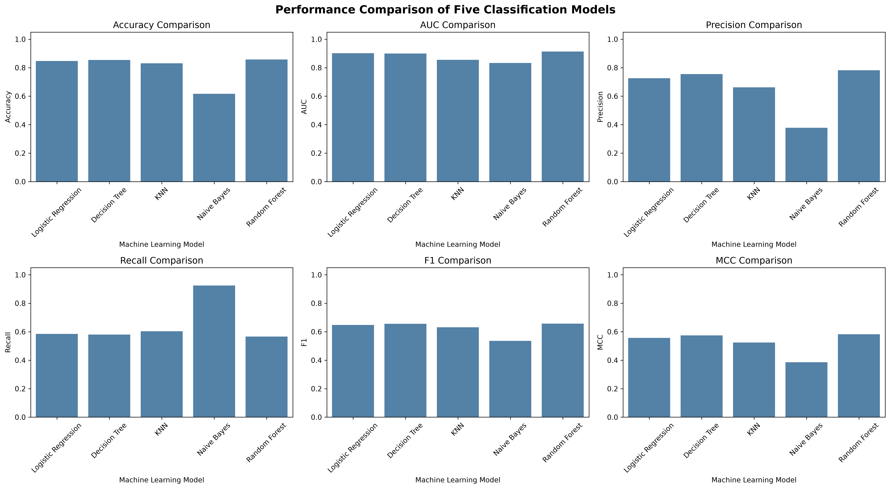

# Adult Income Classification

## Project Overview

This machine learning project predicts whether a person's annual income is **greater than $50,000** or **less than or equal to $50,000** using demographic and employment-related attributes from the Adult Income dataset.

Five classification algorithms are trained and evaluated:

1. Logistic Regression
2. Decision Tree
3. K-Nearest Neighbors (KNN)
4. Gaussian Naive Bayes
5. Random Forest

The models are compared using **Accuracy, AUC, Precision, Recall, F1 Score, and Matthews Correlation Coefficient (MCC)**.

---

## Dataset

The project uses the **Adult Income dataset**, also known as the Census Income dataset. The target column is `income`.

### Target Classes

- `<=50K`: Annual income is less than or equal to $50,000
- `>50K`: Annual income is greater than $50,000

### Main Features

| Feature | Description |
|---|---|
| `age` | Age of the individual |
| `workclass` | Employment category |
| `fnlwgt` | Final sampling weight |
| `education` | Highest education level |
| `education-num` | Education level represented numerically |
| `marital-status` | Marital status |
| `occupation` | Occupation category |
| `relationship` | Family relationship category |
| `race` | Race category recorded in the dataset |
| `sex` | Sex category recorded in the dataset |
| `capital-gain` | Capital gains |
| `capital-loss` | Capital losses |
| `hours-per-week` | Weekly working hours |
| `native-country` | Country of origin |
| `income` | Target variable |

---

## Project Structure

```text
adult-income-classification/
├── README.md
├── requirements.txt
├── adult.csv
├── test_data.csv
├── ML_Assignment_2026CT05178.ipynb
├── model/
└── results/
    ├── model_comparison.csv
    └── model_comparison_graph.png
```

---

## Project Workflow

### 1. Data Loading

The Adult Income dataset is loaded into a pandas DataFrame and inspected for column types, missing values, duplicate records, and class distribution.

### 2. Data Preprocessing

The preprocessing stage includes:

- Replacing missing-value markers such as `?`
- Removing leading and trailing spaces
- Handling missing records
- Separating input features and the target variable
- Encoding categorical features
- Scaling numerical features where required
- Splitting the data into training and testing sets

### 3. Model Training

The following scikit-learn classification models are trained:

- `LogisticRegression`
- `DecisionTreeClassifier`
- `KNeighborsClassifier`
- `GaussianNB`
- `RandomForestClassifier`

### 4. Model Evaluation

Each model is evaluated using:

- **Accuracy**: Overall proportion of correct predictions
- **AUC**: Ability to distinguish between the two income classes
- **Precision**: Proportion of positive predictions that are correct
- **Recall**: Proportion of actual positive records identified correctly
- **F1 Score**: Harmonic mean of precision and recall
- **MCC**: Balanced measure based on all four confusion-matrix outcomes

---

## Model Comparison

| Machine Learning Model | Accuracy | AUC | Precision | Recall | F1 | MCC |
|:---|---:|---:|---:|---:|---:|---:|
| Logistic Regression | 0.8477 | 0.902 | 0.730 | 0.590 | 0.650 | 0.560 |
| Decision Tree | 0.8530 | 0.900 | 0.760 | 0.580 | 0.660 | 0.570 |
| K-Nearest Neighbors | 0.8290 | 0.850 | 0.660 | 0.600 | 0.630 | 0.520 |
| Gaussian Naive Bayes | 0.6160 | 0.830 | 0.380 | 0.920 | 0.540 | 0.380 |
| Random Forest | 0.8600 | 0.910 | 0.780 | 0.570 | 0.660 | 0.580 |

> **Note:** The values above summarize the generated comparison output. If the notebook produces slightly different values after rerunning, update this table from `results/model_comparison.csv`.

---

## Performance Visualization

The following figure compares all five models across the six evaluation metrics.



---

## Key Findings

- **Random Forest** provides the strongest overall performance, with the highest accuracy, AUC, precision, and MCC among the evaluated models.
- **Decision Tree** achieves a competitive F1 score and strong precision.
- **Logistic Regression** provides a reliable and interpretable baseline.
- **Gaussian Naive Bayes** achieves the highest recall, but its lower precision and accuracy indicate a larger number of false-positive predictions.
- The best model depends on the objective. Random Forest is suitable for balanced overall performance, while Gaussian Naive Bayes may be considered when identifying as many `>50K` cases as possible is more important than limiting false positives.

---

## Technologies Used

- Python
- Jupyter Notebook
- pandas
- NumPy
- scikit-learn
- Matplotlib
- Seaborn

---

## Installation

### 1. Clone the Repository

```bash
git clone https://github.com/2026ct05178/adult-income-classification.git
cd adult-income-classification
```

### 2. Create a Virtual Environment

#### Windows PowerShell

```powershell
python -m venv .venv
.venv\Scripts\Activate.ps1
```

#### Linux or macOS

```bash
python3 -m venv .venv
source .venv/bin/activate
```

### 3. Install the Required Packages

```bash
pip install -r requirements.txt
```

### 4. Start Jupyter Notebook

```bash
jupyter notebook
```

Open `ML_Assignment_2026CT05178.ipynb`, select **Run All**, and review the generated model results.

---

## Expected Output Files

After running the notebook, the following files should be available:

- `results/model_comparison.csv`: Tabular comparison of model performance
- `results/model_comparison_graph.png`: Six-panel performance comparison chart
- `model/`: Directory for the trained model, if model persistence is included

---

## Reproducibility

For reproducible results:

- Keep the same train-test split
- Set `random_state` for models and data splitting
- Use the package versions listed in `requirements.txt`
- Apply the same preprocessing steps to both training data and new test data

---

## Conclusion

This project demonstrates an end-to-end binary classification workflow using the Adult Income dataset. The comparison shows that Random Forest offers the best overall performance among the five evaluated models, while Gaussian Naive Bayes produces the highest recall. Evaluating multiple metrics provides a more reliable model assessment than selecting a model using accuracy alone.

---

## Author

**Wasim Akram Dudekula**  
Student ID: **2026CT05178**
